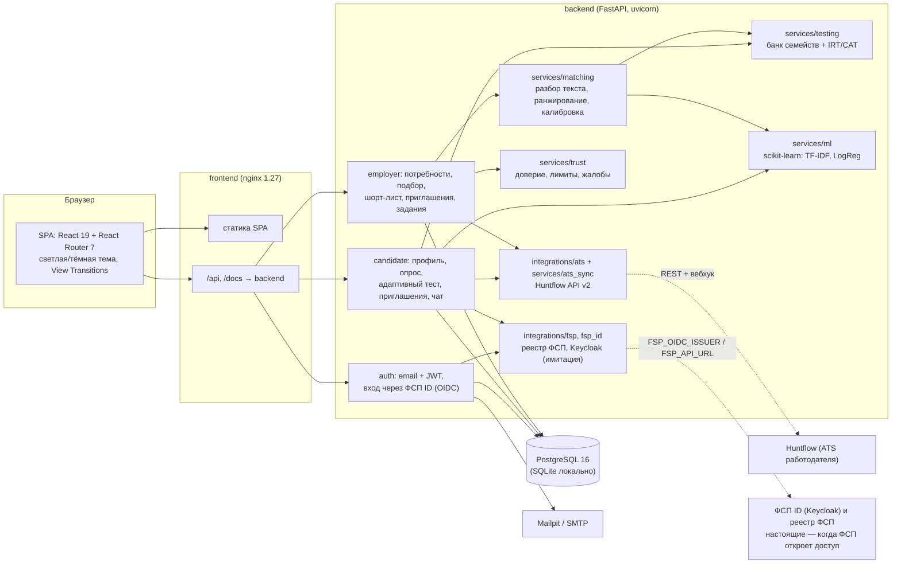

# Архитектура

## Компоненты

| Слой | Где в коде | Что делает |
|---|---|---|
| API | `backend/app/api/` | Роутеры `auth`, `public`, `candidate`, `employer`; правила видимости данных в `common.py`, переписка в `messaging.py` |
| Тестирование | `backend/app/services/testing/` | Параметрические семейства заданий (`item_bank.py`), 2PL IRT и адаптивный выбор (`cat.py`), профиль навыков, сигналы честности (`service.py`) |
| Подбор | `backend/app/services/matching/` | Разбор текста вакансии и резюме, модель релевантности из трёх уровней, изотоническая калибровка (`ranking.py`, `calibration.json`) |
| Интеграции | `backend/app/integrations/` | Реестр ФСП (`fsp.py`: mock и HTTP-клиент), ФСП ID по OpenID Connect (`fsp_id.py`: mock и Keycloak), Huntflow (`ats.py`: mock и HTTP-клиент) |
| Доверие | `backend/app/services/trust.py` | Оценка доверия к работодателю, суточные лимиты, жалобы и автоприостановка, флаг вилки-приманки |
| ATS | `backend/app/services/ats_sync.py`, `app/api/integrations.py` | Передача кандидата и этапов в Huntflow, вебхук этапов, импорт вакансий |
| ML и NLP | `backend/app/services/ml.py` | Классификатор специализации по тексту, нечёткое распознавание навыков, подсказка грейда (scikit-learn) |
| Данные | `backend/app/models/entities.py` | SQLAlchemy 2. Схема создаётся при старте, недостающие колонки добавляет `ensure_columns()` |
| Фронтенд | `frontend/src/` | Страницы кандидата и работодателя, `ui.tsx` — дизайн-система (тема, тосты, скелетоны, кольцо релевантности, чат), `fspid.tsx` — вход через ФСП ID, `i18n.ts` — переключение RU / EN |

## Ключевые потоки

**Кандидат.** Регистрация по email или вход через ФСП ID → опрос с самооценкой (кандидат сам выбирает одну из 6 ступеней,
ML-модель подсказывает) → адаптивный тест (12–22 задания, до 20 минут, варианты генерируются заново, правильный ответ
не уходит в браузер) → категория. Уверенный результат — система сразу предлагает тест на ступень выше. Если грейд не подтверждён, кандидат остаётся в выдаче со статусом «не подтверждён» и ниже
подтверждённых. Дальше согласие на публикацию → приглашения → переписка → принятие (контакты открываются,
доступ можно отозвать) → оффер → выход на работу. Адресные регулярные задания поддерживают актуальность профиля.

**Работодатель.** Потребность свободным текстом → разбор в специализацию, грейд, стек и вилку (NLP-подсказки
по опечаткам) → шаг 1: карточки рекомендованных категорий → шаг 2: объяснимая подборка (6 блоков, покрытие каждого требования, флаги) → шорт-лист → адресное приглашение
с вилкой до вычета НДФЛ → переписка → контакты после согласия кандидата. Дополнительно — регулярные задания:
с эталоном их проверяет система, открытые оценивает работодатель. Статусы приглашений и кандидаты синхронизируются
с Huntflow.

## Нагрузка и стенд

* Эндпоинты синхронные и выполняются в пуле потоков uvicorn, БД — PostgreSQL с `pool_pre_ping`.
* Проверка на ноутбуке (SQLite, один процесс uvicorn): 60 запросов к самым тяжёлым эндпоинтам (подборка
  по потребности, поиск по банку, профиль, приглашения) в 50 параллельных потоков — 0 ошибок, p50 0,7 с, p95 1,4 с.
* GPU и внешние сервисы не нужны: тест, подбор, калибровка и ML-модели считаются на CPU (numpy, scikit-learn;
  модели обучаются при первом обращении менее чем за 2 секунды). Целевой стенд жюри
  (32–64 ГБ RAM, ~8 CPU) с запасом покрывает десятки одновременных пользователей.
* Масштабирование: несколько реплик backend за nginx (состояние только в БД), отдельный read-replica для подборки.
  Одноразовость кода имитированного ФСП ID хранится в памяти процесса. С реальным Keycloak её гарантирует сам Keycloak.

## Безопасность и данные

* JWT HS256 с claims в формате Keycloak (`sub`, `email`, `realm_access.roles`). Переход на токены ФСП ID меняет только проверку ключа.
* Пароли — bcrypt. Правильные ответы теста хранятся только на сервере. Ответ после лимита времени не засчитывается.
* Обезличенные карточки: до согласия кандидата видны «Кандидат #N», категория, проверенные навыки и ФСП.
  Контакты открываются только по принятому приглашению или отклику, и кандидат может отозвать доступ.
* 152-ФЗ: согласие на обработку при регистрации или на экране ФСП ID, отдельное согласие на публикацию,
  согласие законного представителя для 15–17 лет, до 15 лет публикация запрещена.
* Защита от фиктивных вакансий: оценка доверия, суточные лимиты, жалобы с автоприостановкой (см. [01-concept.md](01-concept.md), раздел 5).
* LLM в рабочем контуре не используется (см. [09-requirements-trace.md](09-requirements-trace.md)), поэтому
  персональные данные не передаются третьим лицам и за рубеж.
