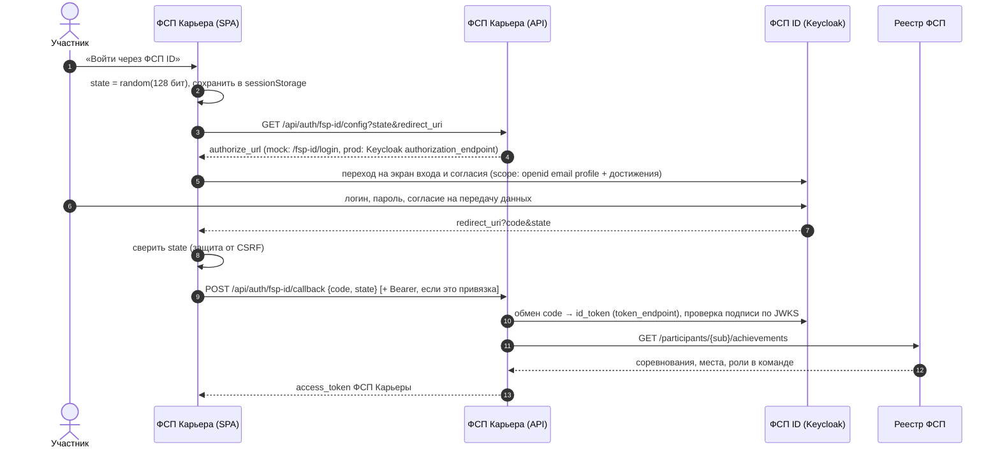

# Интеграция с ФСП и ФСП ID

Доступа к настоящему ФСП ID (Keycloak) и к API реестра на хакатоне нет — ФСП его не выдаёт. По ответам постановщиков достаточно имитировать
подключение и заложить скелет будущей интеграции на своих данных. Ниже — что сделано и как это переключится на настоящий ФСП ID, когда ФСП откроет доступ.

## 1. Вход и привязка через ФСП ID (OpenID Connect, Authorization Code)



* **Ключ привязки — `sub` из id_token.** Кандидат не вводит ID вручную, поэтому привязать чужой профиль нельзя.
  Один ФСП ID — один профиль (иначе 409).
* **Три сценария в одном callback:** вход по уже привязанному ФСП ID; вход по email из ФСП ID (профиль связывается);
  создание нового кандидата (email подтверждён на стороне ФСП ID, согласие на обработку ПДн дано на экране согласия).
  Если пользователь уже вошёл, тот же поток привязывает ФСП ID к текущему профилю.
* **Имитация (`MockFspIdProvider`).** Экран входа `/fsp-id/login` рисует фронтенд и явно подписан как имитация.
  Код — короткоживущий (120 с) одноразовый JWT, внутри него `state`. Неверный пароль, чужой `state`
  и повторное использование кода отклоняются (покрыто тестами `tests/test_qa_requirements.py`).
* **Режим с настоящим Keycloak (`KeycloakOidcProvider`)** включается переменными окружения, код вызова не меняется:

```env
FSP_OIDC_ISSUER=https://id.fsp-russia.com/realms/fsp
FSP_OIDC_CLIENT_ID=fsp-career
FSP_OIDC_CLIENT_SECRET=...
```

  Discovery через `/.well-known/openid-configuration`, обмен кода на `token_endpoint`, проверка `id_token`
  по `jwks_uri` (RS256, `aud`, `iss`). Поднимать Keycloak в Docker Compose по ответам постановщиков не требуется.

## 2. Реестр достижений

Предлагаемый контракт (`backend/app/integrations/fsp.py`):

```
GET /participants/{fsp_id}               → { full_name, region, sport_rank }
GET /participants/{fsp_id}/achievements  → [{ event_name, discipline, level, event_date, place,
                                              participants, role_in_team, skills[], source_url }]
```

`MockFspClient` выдаёт детерминированный синтетический реестр: один и тот же ID всегда даёт одни и те же данные.
ID, оканчивающиеся на `0`, — участники без истории (обязательный сценарий «истории нет»). `HttpFspClient`
включается переменными `FSP_API_URL` и `FSP_API_TOKEN`.

## 3. Как достижения влияют на подбор

По ответам постановщиков:

| Правило | Реализация |
|---|---|
| Грейд даёт только тест | Достижения не участвуют в присвоении грейда (`services/testing/service.py`) |
| ФСП поднимает внутри категории | Отдельный блок-бонус: закрывает долю разрыва до 100%, отсутствие ФСП не штрафуется |
| Все соревнования равнозначны | Уровень мероприятия (региональное, всероссийское, международное) **не взвешивается** |
| Профильность дисциплины (идея постановщиков) | Коэффициент 0.6–1.0 по паре «дисциплина — специализация»: ИБ-специалисту CTF важнее робототехники, бэкендеру — продуктовое и алгоритмическое программирование (`catalog.FSP_DISCIPLINE_RELEVANCE`) |
| Разряды | Спортивный разряд из реестра показывается работодателю рядом с бейджем ФСП, в балл не входит |
| Число стартов и результативность | Победа 1.0, призовое место 0.85, топ-10 0.55, участие 0.2 |
| Нельзя набить профиль онлайн-явками | Суммарный вклад участий без высокого места ограничен 0.5 |
| Свежий результат весит больше | −15% за каждый год давности, но не ниже 50% |
| Вклад в командный хакатон не выделяется | Роль в команде показывается работодателю, но в балл не входит |
| Задачи прошлых соревнований | Не используются в тесте, поэтому участники, решавшие их раньше, не получают преимущества |

Работодатель видит строку вида «3 мероприятия (побед: 1, призовых: 1), лучшее — «…», 1 место».
Кандидат может скрыть достижения настройкой приватности.
